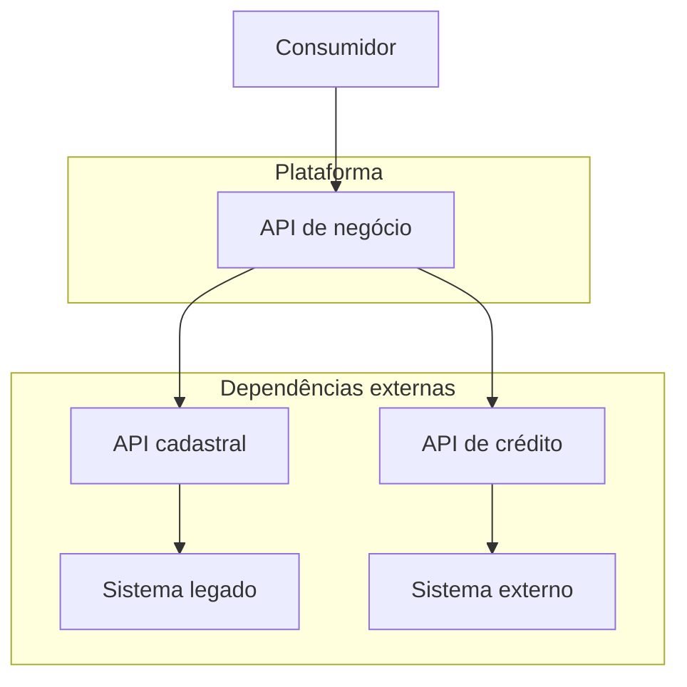
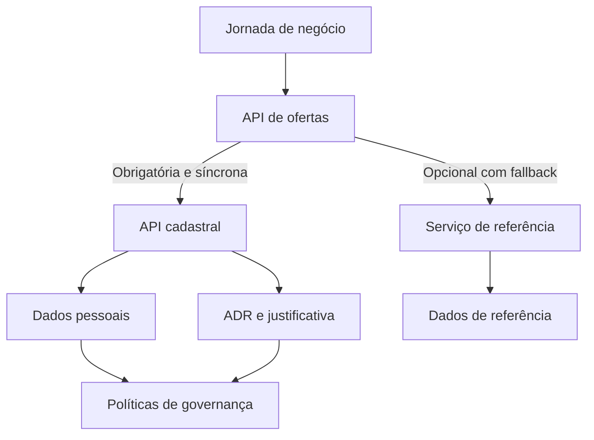
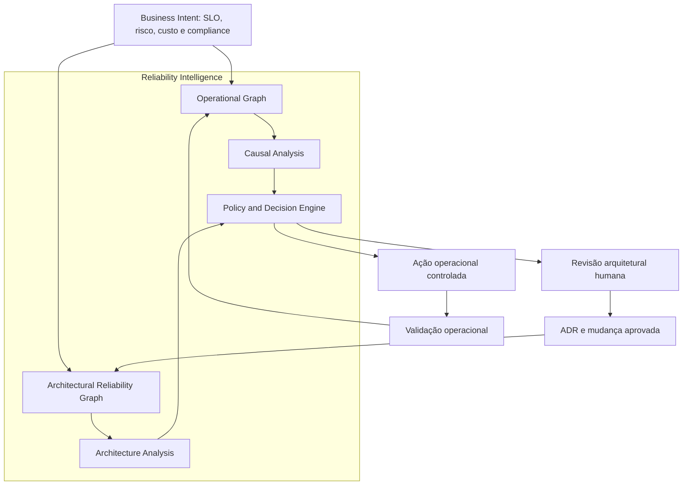

# Architectural Reliability Intelligence — A confiabilidade como propriedade emergente de sistemas distribuídos

**Data:** 2026-11-24  
**Status:** Brainstorm — reflexão estratégica e proposta conceitual  
**Documento complementar:** [O futuro da observabilidade e da engenharia de confiabilidade](2026-11-24-futuro-observabilidade-engenharia-confiabilidade.md)

## 1. Contexto e tese

A confiabilidade é uma propriedade emergente da composição arquitetural de uma solução, não exclusivamente da infraestrutura que a sustenta. Em sistemas distribuídos, dependências externas e transitivas podem determinar a disponibilidade, a latência e a qualidade percebida pelo consumidor, mesmo quando a plataforma opera adequadamente.

Quando não há uma explicação simples para uma degradação, é comum atribuir responsabilidade à infraestrutura, por ser a base que suporta a execução e onde muitos sintomas se manifestam. Entretanto, o lugar onde a degradação se manifesta não é necessariamente onde ela se origina.

Um sistema inteligente de análise deve ir além de identificar falhas na infraestrutura ou na aplicação: deve demonstrar como decisões arquiteturais cobram um preço em qualidade, disponibilidade e capacidade de atender demandas de negócio. Não se trata de isentar a plataforma, mas de atribuir causalidade com evidências e reconhecer responsabilidades compartilhadas.

## 2. Dependências distribuídas e limites de observação



Uma API pode consumir apenas 20 ms em processamento local e ainda responder em mais de um segundo devido a chamadas obrigatórias. Se as chamadas forem sequenciais, seus tempos se acumulam; se forem paralelas, o caminho crítico e os pontos de sincronização determinam a latência. Filas, retries, timeouts e contenção podem ampliar o impacto.

A observabilidade da plataforma não equivale à observabilidade integral da solução. Uma chamada externa lenta pode ser identificada na fronteira, mas sua causa interna não pode ser afirmada sem evidências adicionais. A ausência de sinais de saturação também não comprova que toda a infraestrutura esteja saudável.

## 3. O custo quantitativo das decisões arquiteturais

Para componentes obrigatórios em série, sob hipótese de independência de falhas e sem fallback, a disponibilidade composta é:

$$A_{solucao} = A_{aplicacao} \times \prod_{i=1}^{n} A_i$$

| Dependências obrigatórias | Disponibilidade individual (incluindo aplicação) | Disponibilidade composta | Indisponibilidade esperada em 30 dias |
|---:|---:|---:|---:|
| 0 | 99,9% | 99,9000% | 43,2 min |
| 1 | 99,9% | 99,8001% | 86,4 min |
| 5 | 99,9% | 99,4015% | 258,6 min |
| 10 | 99,9% | 98,9055% | 472,8 min |

O modelo é ilustrativo: falhas correlacionadas, redundância, dependências compartilhadas, disponibilidade condicional por jornada e degradação funcional exigem modelos mais ricos. Não se deve multiplicar indiscriminadamente todos os nós de um grafo, nem tratar SLOs declarados como probabilidades medidas.

Para latência, percentis de serviços não são aditivos. É necessário analisar traces individuais, distribuições conjuntas, caminho crítico, tempos exclusivos e sobreposição de spans. O P99 de ponta a ponta deve ser medido na fronteira da jornada.

**Decisões arquiteturais consomem orçamento de confiabilidade.** Uma solução pode nascer incompatível com o objetivo de negócio mesmo sobre uma plataforma de alta qualidade.

## 4. Architectural Cause Analysis (ACA)

Propõe-se ACA como dimensão complementar à RCA, não como metodologia padronizada ou substituição da análise de incidentes.

| RCA | ACA |
|---|---|
| O que desencadeou a falha? | Por que a arquitetura permitiu esse impacto? |
| Qual componente degradou? | Por que a solução depende fortemente dele? |
| Como restaurar o serviço? | Como reduzir a vulnerabilidade estrutural? |
| Qual evento ocorreu? | Quais decisões potencializaram suas consequências? |

Uma dependência externa que degrada diariamente pode provocar incidentes repetidos. Sua lentidão é o evento desencadeador; a obrigatoriedade síncrona, a ausência de isolamento ou a impossibilidade de degradação funcional podem explicar a extensão do impacto.

A análise deve distinguir evento, mecanismos de propagação, condições contribuintes e decisões estruturais, sem presumir uma causa única. Deve também identificar evidências contrárias e hipóteses alternativas.

## 5. Reliability Debt — dívida de confiabilidade

| Decisão | Potencial custo |
|---|---|
| Dependência síncrona obrigatória | Propagação de indisponibilidade |
| Encadeamento profundo de APIs | Latência acumulada |
| Ausência de circuit breaker ou bulkhead | Propagação de saturação |
| Retries indiscriminados | Amplificação de falhas |
| Fonte de dados centralizada | Concentração de risco |
| Ausência de fallback | Indisponibilidade funcional |
| Terceiros sem SLO conhecido | Risco não quantificado |
| Acoplamento entre domínios | Ampliação do blast radius |

Nem toda decisão dessa natureza é equivocada. Consistência, segurança, custo, compliance e necessidades de negócio podem justificá-la. A dívida deve representar risco residual conhecido e não mitigado, e não simplesmente a existência de uma dependência.

Complemento proposto: registrar decisão/ADR, justificativa, jornada afetada, evidência, impacto no error budget, alternativas, restrições, responsável, risco aceito e data de revisão. Evitar pontuações arbitrárias: estimativas devem explicitar método e incerteza.

## 6. Governança, compliance e natureza da informação

Uma recomendação de cache, replicação ou processamento assíncrono pode ser tecnicamente atraente, mas incompatível com requisitos de atualização, integridade, finalidade ou regulamentação.

A LGPD não proíbe genericamente cache ou replicação de dados pessoais. A admissibilidade depende do tratamento concreto, base legal, finalidade, necessidade, segurança, retenção, direitos dos titulares e demais obrigações aplicáveis. Requisitos setoriais e políticas internas também devem ser considerados.

Uma decisão viável deve conciliar necessidade de negócio, viabilidade técnica e governança. O LLM não deve conceder aprovação jurídica nem inferir permissões ausentes. Restrições desconhecidas exigem revisão humana.

A própria telemetria pode conter dados pessoais, segredos e payloads sensíveis. A inteligência deve operar com minimização, mascaramento, controle de acesso, segregação, retenção e trilha de auditoria. Conteúdo de logs e documentos deve ser tratado como dado não confiável, não como instrução para agentes.

## 7. Architectural Reliability Graph

Evolução do Knowledge Graph operacional: representar não apenas a topologia observada, mas a semântica das dependências, sua justificativa e as restrições que condicionam alternativas.



Contrato ilustrativo:

```yaml
dependency:
  source: ofertas-api
  target: cadastro-api
  ownership:
    domain: cadastro
    platformManaged: false
  interaction:
    type: synchronous
    criticality: mandatory
    fallbackAvailable: false
  reliability:
    availabilitySLO: 99.9
    latencyBudgetMs: 150
    timeoutMs: 1000
  dataGovernance:
    classification: personal
    localPersistence: requiresReview
    cacheAllowed: requiresReview
  architecture:
    decisionRef: ADR-0042
    businessJustification: consulta atualizada
```

O modelo deve distinguir topologia declarada de topologia observada, SLO contratado de SLI medido, dependências por endpoint/jornada, dependências transitivas, proprietário, origem e validade temporal da informação. Divergências entre ADRs e comportamento observado devem gerar revisão, não alteração automática de arquitetura.

Fontes possíveis: OpenTelemetry, service mesh, catálogo de serviços, OpenAPI, ADRs, inventário de infraestrutura, contratos de serviço, políticas de dados e histórico de incidentes. Traces amostrados ou incompletos não são inventário exaustivo.

## 8. Exemplo de análise inteligente

Cenário hipotético: API de ofertas com P99 observado de 1.820 ms e objetivo de 250 ms. Um trace representativo de 1.820 ms, assumindo contribuições exclusivas e sequenciais no caminho crítico, apresenta:

| Contribuição | Tempo |
|---|---:|
| Processamento local | 20 ms |
| Infraestrutura e rede | 50 ms |
| Dependências diretas (tempo exclusivo) | 650 ms |
| Dependências transitivas (tempo exclusivo) | 1.100 ms |

O trace é ilustrativo e não demonstra, isoladamente, a composição de todo o P99.

- **Observação:** não foram encontradas evidências de saturação nos componentes observados da plataforma.
- **Causa operacional provável:** latência nas dependências externas, incluindo transitivas quando instrumentadas.
- **Causa arquitetural provável:** acoplamento síncrono obrigatório sem degradação funcional.
- **Limite de conhecimento:** causas internas de sistemas sem instrumentação permanecem desconhecidas.
- **Restrição:** cache e replicação de dados pessoais exigem avaliação de governança.
- **Recomendação:** reavaliar a composição da solução, o caminho crítico e a necessidade de consultas síncronas. Aumentar réplicas não atua diretamente sobre a latência externa identificada, embora possa mitigar efeitos locais em certas condições.

### Contrato de saída do agente

Cada análise deve registrar escopo e janela temporal, SLO afetado, evidências rastreáveis, hipóteses e alternativas, grau de confiança justificado, lacunas de observação, impacto de negócio, decisões arquiteturais associadas, restrições, recomendações operacionais e estruturais, responsáveis e critérios de validação.

O LLM deve sintetizar e formular hipóteses; cálculos, correlações temporais e verificações de política devem preferencialmente ser realizados por ferramentas verificáveis. Recomendações não devem ser confundidas com autorização de execução.

## 9. Responsabilidade institucional e fronteiras de confiabilidade

Existe assimetria quando uma equipe é responsabilizada pela disponibilidade de uma solução sem autoridade sobre suas decisões arquiteturais. A análise deve distinguir:

- Confiabilidade da plataforma.
- Confiabilidade dos componentes da aplicação.
- Confiabilidade das dependências externas.
- Confiabilidade da composição arquitetural.
- Confiabilidade percebida pelo consumidor.

SLOs de plataforma e de jornada devem coexistir, com contratos explícitos nas fronteiras. A atribuição causal não deve se transformar em atribuição de culpa: infraestrutura, aplicação e dependências podem contribuir simultaneamente. O objetivo é orientar investimento e decisão, não produzir mecanismos de isenção.

## 10. Evolução do Reliability Control Plane



Dois ciclos complementares:

- **Operacional:** preservar ou restaurar o estado do sistema em segundos, minutos ou horas; mitigação, recuperação e validação.
- **Arquitetural:** reduzir vulnerabilidades estruturais em dias, semanas ou meses; análise de recorrência, revisão de ADRs, avaliação de alternativas e validação posterior.

O primeiro reduz impacto; o segundo busca reduzir vulnerabilidade. Mudanças estruturais permanecem sujeitas a governança e decisão humana.

## 11. Complemento: caminho para uma prova de conceito

1. Selecionar uma jornada com dependência externa relevante e SLO explícito.
2. Instrumentar a fronteira e construir um grafo mínimo com dependências diretas, transitivas conhecidas, proprietários e ADRs.
3. Implementar análise somente leitura de traces, métricas, eventos e histórico, com evidências vinculadas às conclusões.
4. Testar cenários controlados de latência externa, saturação local, falhas combinadas e ausência de telemetria.
5. Comparar diagnósticos com análise humana, medindo precisão da atribuição, hipóteses sem suporte, cobertura, tempo de investigação e utilidade das recomendações.
6. Registrar riscos estruturais e validar se mudanças aprovadas reduzem recorrência ou consumo de error budget.

Critérios de sucesso: não atribuir causa interna a componentes invisíveis, não recomendar tratamento de dados sem considerar políticas, distinguir sintomas de mecanismos de propagação e produzir recomendações verificáveis. A automação de ações não é requisito da primeira etapa.

## 12. Reflexão final

Três perguntas fundamentalmente diferentes precisam coexistir:

1. O sistema está funcionando conforme foi projetado?
2. O sistema foi projetado para funcionar conforme o negócio necessita?
3. As decisões arquiteturais continuam justificadas diante das evidências operacionais?

A primeira pertence predominantemente à operação; a segunda, à arquitetura; a terceira estabelece um ciclo contínuo de aprendizado entre ambas.

**O verdadeiro potencial da inteligência artificial aplicada à confiabilidade talvez não esteja apenas em automatizar a operação, mas em fechar o ciclo de feedback entre a concepção arquitetural de uma solução e as consequências reais de sua existência em produção.**

A observabilidade torna-se um mecanismo de avaliação contínua das decisões de engenharia. A confiabilidade não é apenas uma propriedade a preservar: é também uma propriedade a projetar, medir e revisar.

## Referências para aprofundamento

- [Google SRE Book — Service Level Objectives](https://sre.google/sre-book/service-level-objectives/)
- [OpenTelemetry — Semantic Conventions](https://opentelemetry.io/docs/specs/semconv/)
- [Lei Geral de Proteção de Dados Pessoais — Lei nº 13.709/2018](https://www.planalto.gov.br/ccivil_03/_ato2015-2018/2018/lei/l13709.htm)

Os contratos, diagramas, conceitos ACA e Architectural Reliability Graph e cenários deste documento são propostas exploratórias, não especificações validadas em produção. As referências são sugestões de aprofundamento; a aplicação jurídica exige avaliação contextual.

## Reflexão complementar: resiliência orientada a falhas

- [Failure-Aware Architecture & Resilience Intelligence](2026-11-25-failure-aware-architecture-resilience-intelligence.md): topologia de falhas, cadeias de eventos, fallback, cobertura de resiliência e evolução arquitetural orientada por evidências.
