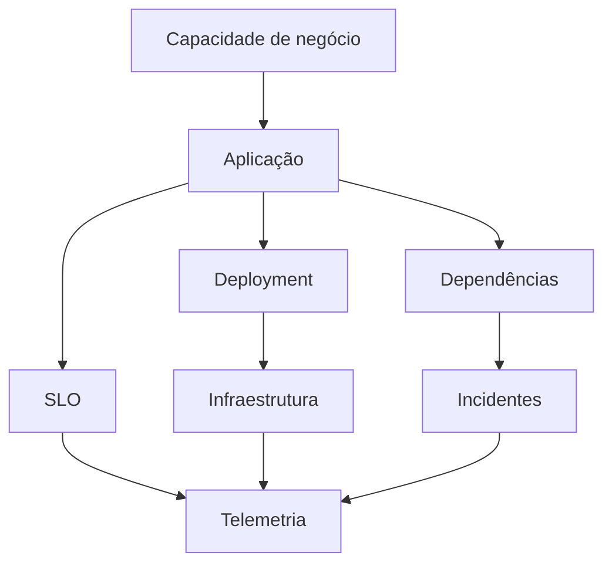
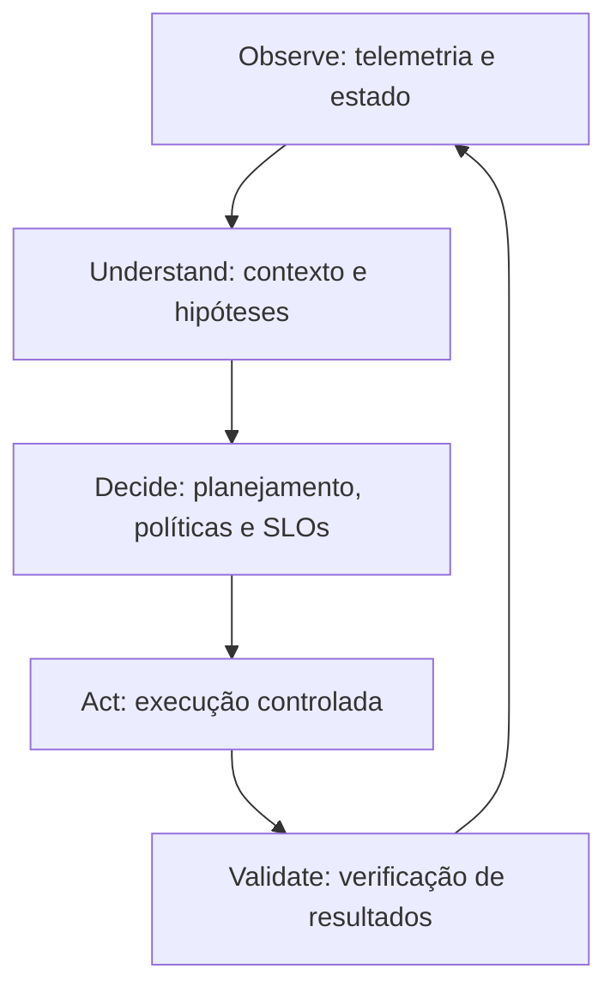
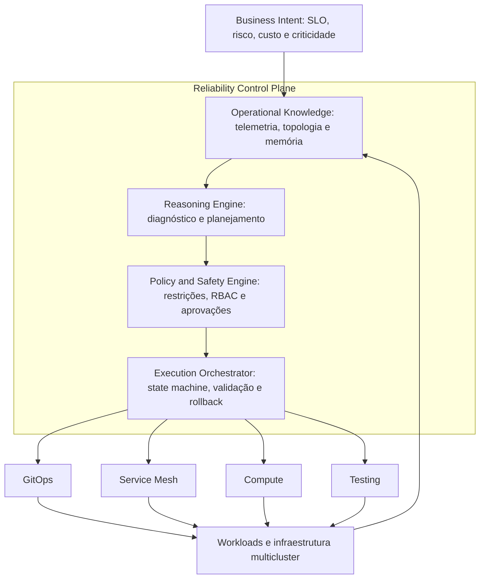

# O futuro da observabilidade e da engenharia de confiabilidade

**Data:** 2026-11-24  
**Status:** Brainstorm — reflexão estratégica e proposta conceitual

## 1. Tese central

O futuro da engenharia de confiabilidade está em construir sistemas capazes de compreender, preservar e restaurar suas próprias condições de funcionamento.

Historicamente, construímos sistemas para serem operados por pessoas. Estamos caminhando para sistemas capazes de se operar dentro de limites e critérios estabelecidos por pessoas. A observabilidade deixa de ser exclusivamente uma capacidade de investigação e passa a integrar o processo de tomada de decisão da infraestrutura.

## 2. Evolução da observabilidade

| Capacidade | Pergunta |
|---|---|
| Monitoramento | O sistema está funcionando? |
| Observabilidade | Por que apresenta esse comportamento? |
| Observabilidade contextual | Qual é o impacto no negócio? |
| Observabilidade preditiva | O que poderá acontecer se essas condições persistirem? |
| Confiabilidade adaptativa | O que o sistema pode fazer para preservar seu funcionamento? |

Essas capacidades são complementares. O objetivo é reduzir a distância entre detecção, compreensão, decisão e ação.

### Observabilidade semântica

O desafio não é apenas disponibilizar dados, mas atribuir significado a eles: correlacionar topologia, dependências, deployments, mudanças, indicadores de negócio, error budgets, capacidade, custos e histórico de incidentes.

OpenTelemetry e suas convenções semânticas oferecem uma base de padronização independente de fornecedor. Knowledge Graphs operacionais podem representar relações entre aplicações, infraestrutura, mudanças e capacidades de negócio.



Um agente que compreende essas relações pode investigar com mais contexto do que um agente que apenas consulta logs. Correlação, contudo, não prova causalidade.

### Agentic SRE e operações autônomas

O AIOps tradicional enfatiza detecção de anomalias e correlação de alertas. A próxima geração incorpora investigação, planejamento, execução e avaliação de resultados.

Uma arquitetura promissora é o Closed-Loop Reliability System:



É uma aplicação de princípios de teoria de controle à confiabilidade, incorporando mecanismos probabilísticos de interpretação. A inteligência pode ser probabilística, mas os limites de atuação devem ser verificáveis e, sempre que possível, determinísticos. Um LLM não deve possuir acesso irrestrito à infraestrutura.

### Reliability as Code

Assim como Infrastructure as Code, Policy as Code e GitOps, a confiabilidade pode ser formalizada declarativamente. Cada aplicação pode possuir um contrato que estabeleça sob quais condições deve operar.

Exemplo conceitual, não uma API Kubernetes existente:

```yaml
apiVersion: reliability.platform.io/v1alpha1
kind: ReliabilityPolicy
metadata:
  name: pagamentos
spec:
  objectives:
    availability: 99.99
    latencyP99: 250ms
  capacity:
    minHealthyReplicas: 10
    minimumHeadroom: 30%
  remediation:
    allowedActions:
      - Scale
      - Rollback
      - ShiftTraffic
      - DrainCluster
    maxConcurrentActions: 1
    requireApproval:
      - DrainCluster
  validation:
    stabilizationWindow: 5m
    rollbackOnDegradation: true
```

O contrato declara objetivos, restrições e capacidades disponíveis, não um procedimento específico para cada incidente.

**Deixamos de programar exclusivamente procedimentos e passamos a programar condições de funcionamento.**

### Engenharia de resiliência contínua

Chaos Engineering, testes sintéticos, simulações de falha, análise de capacidade e experimentos controlados podem verificar continuamente propriedades do sistema. Não basta possuir um mecanismo de failover: é preciso produzir evidências atualizadas de que ele continua funcionando após mudanças na arquitetura.

### Confiabilidade econômica

SRE e FinOps tendem a convergir. Disponibilidade absoluta não é economicamente racional para todas as aplicações. É necessário equilibrar confiabilidade, performance e custo conforme o valor de negócio e o risco mitigado.

Aumentar capacidade pode melhorar disponibilidade, mas também gerar custo desproporcional ao benefício. O SRE passa a participar diretamente da otimização dessas variáveis.

## 3. O futuro do profissional de SRE

| SRE tradicional | SRE do futuro |
|---|---|
| Construir dashboards | Construir modelos operacionais |
| Configurar alertas | Definir critérios de intervenção |
| Investigar incidentes | Engenheirar capacidades de investigação |
| Executar runbooks | Construir mecanismos de atuação |
| Realizar failover | Projetar sistemas adaptativos |
| Escrever post-mortems | Construir memória operacional reutilizável |
| Operar infraestrutura | Governar sistemas autônomos |
| Garantir disponibilidade | Otimizar confiabilidade, risco e custo |

O valor profissional tende a migrar da execução de operações para o projeto dos sistemas que executam essas operações. Sistemas distribuídos, teoria de controle, engenharia de dados, IA, modelagem de risco e governança ganham relevância. Fundamentos clássicos como SLOs, error budgets e redução de toil continuam essenciais.

## 4. Aplicação em uma plataforma multicluster

Uma plataforma interna pode reunir as seguintes capacidades, independentemente do fornecedor:

| Componente | Responsabilidade |
|---|---|
| Telemetria e agregação de logs | Percepção do estado operacional |
| Orquestrador e generator plugin | Controle e reconciliação de estado |
| ConfigMaps e ApplicationSet | Representação declarativa da intenção |
| Istio e Argo Rollouts | Controle de tráfego e releases |
| Karpenter e Kubernetes | Controle de capacidade computacional |
| Gateway de descoberta de APIs | Validação funcional |
| Policy engine e gestão de mudanças | Governança das intervenções |

### Exemplo: drain e attach inteligentes

Um mecanismo convencional executa uma instrução: drenar um cluster. Um mecanismo adaptativo preserva uma propriedade: a capacidade de atendimento do workload durante a drenagem.

Antes de remover tráfego e reduzir réplicas no cluster de origem, o orquestrador aquece o cluster de destino, valida capacidade e saúde, transfere tráfego e verifica os resultados. Parâmetros transitórios devem ser reconciliados e restaurados de forma segura, sem perder a intenção declarativa original.

A contagem de réplicas, isoladamente, não comprova capacidade equivalente: throughput, saturação, latência e disponibilidade precisam participar da validação.

## 5. Proposta: Reliability Control Plane



A IA não é o control plane: é um componente responsável pelo raciocínio. O orquestrador permanece responsável pela execução determinística e reconciliação de estados. A camada de inteligência formula hipóteses, propõe intervenções e avalia evidências junto aos mecanismos objetivos de validação.

A adoção deve começar com autonomia supervisionada, avançando para intervenções automáticas de baixo risco conforme existam evidências de segurança e eficácia. Ações precisam de escopo limitado, auditoria, pré-condições, controle de concorrência, critérios de interrupção e mecanismos de recuperação. Na ausência de evidências suficientes, o sistema deve abster-se ou solicitar aprovação.

## 6. Perspectiva para 2027–2035

Projeção exploratória, não um calendário confirmado pelo mercado:

- **2027–2028 — SRE assistido por IA:** investigação automatizada, diagnóstico contextual, redução do trabalho de on-call e planos de mitigação.
- **2029–2031 — Confiabilidade adaptativa:** agentes supervisionados, contratos declarativos, memória operacional e resolução autônoma de classes conhecidas de incidentes.
- **2032–2035 — Autonomia operacional delimitada:** plataformas ajustando capacidade, topologia, tráfego e releases continuamente, respeitando objetivos de negócio e restrições de risco.

A adoção será desigual. Complexidade, qualidade dos dados, governança e limites de segurança continuarão relevantes.

## 7. Reflexão final

**Automação é a capacidade de executar uma ação sem intervenção humana. Autonomia é a capacidade de determinar qual ação precisa ser executada para preservar um objetivo.**

Durante muito tempo, a engenharia de confiabilidade investiu predominantemente na primeira. A próxima fronteira pode ser a segunda, tendo a observabilidade como substrato informacional.

O maior desafio do SRE do futuro não será ensinar uma máquina a resolver um incidente. Será definir, com precisão suficiente, o que significa um sistema estar funcionando adequadamente, quais propriedades precisam ser preservadas e quais decisões estamos dispostos a delegar.

## Referências para aprofundamento

- [Google SRE — AI in SRE: How Google is Engineering the Future of Reliable Operations](https://sre.google/resources/practices-and-processes/ai-engineering-reliable-operations/)
- [OpenTelemetry — Semantic Conventions](https://opentelemetry.io/docs/specs/semconv/)

As propostas arquiteturais e projeções deste brainstorm são hipóteses para exploração, não especificações validadas em produção.

## Reflexão complementar

- [Architectural Reliability Intelligence — A confiabilidade como propriedade emergente de sistemas distribuídos](2026-11-24-architectural-reliability-intelligence.md): amplia o Reliability Control Plane com análise causal e arquitetural, dependências externas, dívida de confiabilidade e governança.

## Reflexão complementar: resiliência orientada a falhas

- [Failure-Aware Architecture & Resilience Intelligence](2026-11-25-failure-aware-architecture-resilience-intelligence.md): topologia de falhas, cadeias de eventos, fallback, cobertura de resiliência e evolução arquitetural orientada por evidências.

## Reflexão complementar: confiabilidade declarativa

- [Declarative Reliability & Adversarial Intelligence](2026-11-26-declarative-reliability-adversarial-intelligence.md): contratos verificáveis, investigação orientada a eventos, evidências e pipelines adversariais.
