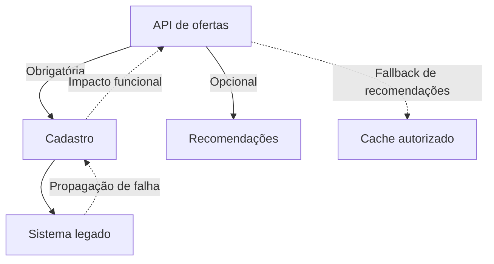
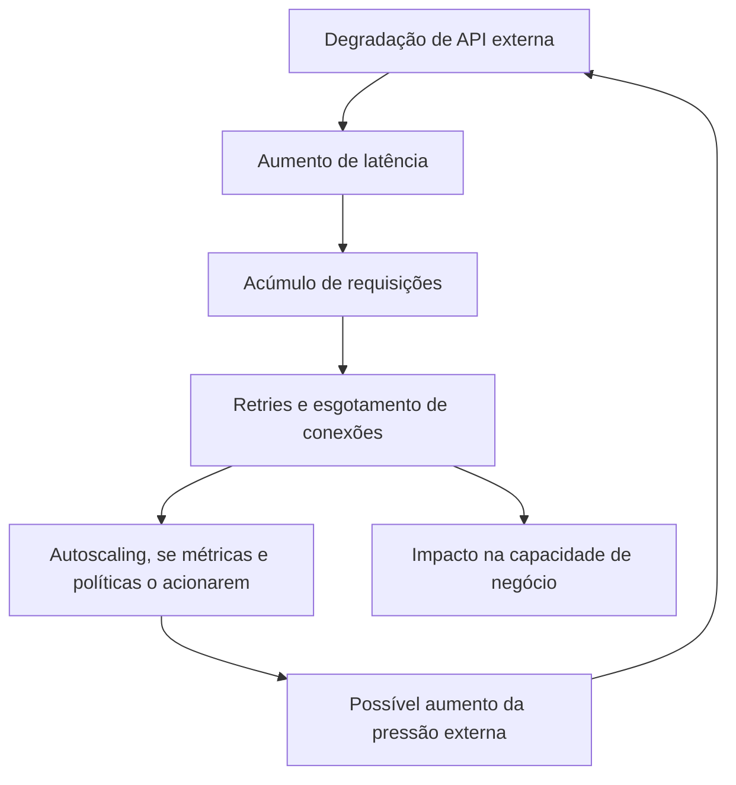
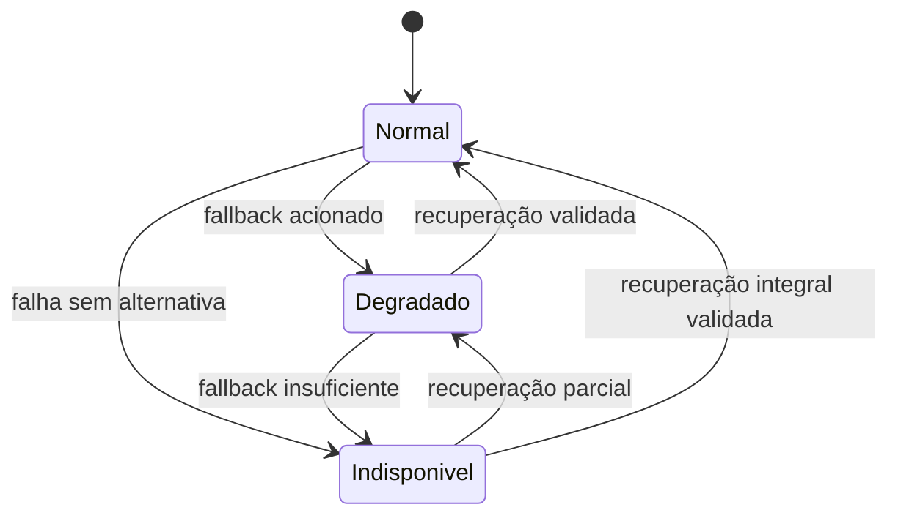
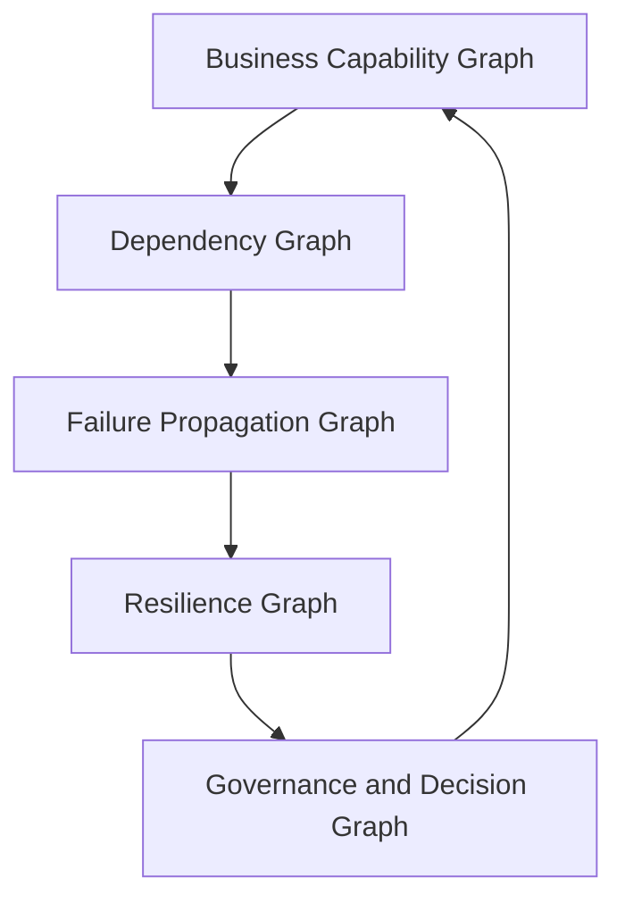
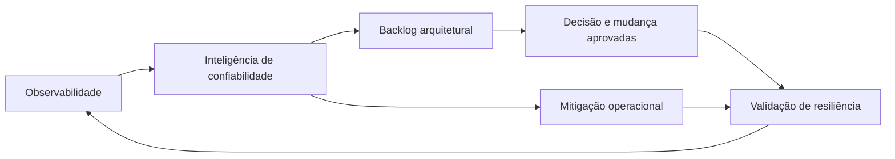

# Failure-Aware Architecture & Resilience Intelligence

**Data:** 2026-11-25  
**Status:** Brainstorm — proposta conceitual

## 1. Tese e contexto

Visões de pontos de falha, cadeias de eventos e fallback em casos de falhas são dimensões de observabilidade que devem nortear a evolução das plataformas de negócios.

A qualidade de uma arquitetura não deve ser avaliada exclusivamente por sua capacidade de funcionar em condições normais, mas pela previsibilidade de seu comportamento quando as condições que sustentam seu funcionamento deixam de existir.

Este documento constitui o terceiro eixo de uma reflexão sobre confiabilidade:

- [O futuro da observabilidade e da engenharia de confiabilidade](2026-11-24-futuro-observabilidade-engenharia-confiabilidade.md): confiabilidade adaptativa e Reliability Control Plane.
- [Architectural Reliability Intelligence](2026-11-24-architectural-reliability-intelligence.md): confiabilidade sistêmica, decisões arquiteturais e dependências distribuídas.

Não basta conhecer a topologia de comunicação. É necessário compreender como falhas percorrem essa topologia, quais mecanismos interrompem sua propagação e quais capacidades de negócio permanecem disponíveis.

## 2. Failure Topology — topologia de falhas



A topologia deve representar pontos únicos de falha físicos e lógicos, dependências obrigatórias e opcionais por jornada, domínios de falha compartilhados, blast radius potencial e observado, isolamento e redundâncias aparentes.

Uma aplicação distribuída em dois clusters pode apresentar alta resiliência computacional e ainda depender de uma única fonte externa de dados. Redundância da infraestrutura não implica redundância da capacidade de negócio.

Complemento: representar também conjuntos de falhas capazes de interromper uma jornada (minimal cut sets), quando o modelo de dependências permitir. A criticidade depende da semântica AND/OR, da capacidade efetiva das alternativas e de falhas de causa comum. Um grafo incompleto não comprova ausência de pontos únicos de falha.

## 3. Failure Propagation — cadeias de eventos



Uma ação operacionalmente correta, analisada isoladamente, pode ser sistemicamente prejudicial. Autoscaling pode agravar a saturação externa quando aumenta concorrência ou demanda efetiva; não é uma consequência inevitável.

O sistema deve identificar evento desencadeador, condições contribuintes, sequência temporal, mecanismos de amplificação, ações de controle, efeitos e evidências contrárias. Proximidade temporal não demonstra causalidade.

Complemento: representar cada evento com timestamp e incerteza temporal, componente, jornada, evidência, mudança associada e relações causais hipotéticas ou verificadas. Considerar clock skew, traces incompletos e efeitos concorrentes. Assinaturas recorrentes podem alimentar a memória operacional e a revisão arquitetural.

## 4. Fallback Observability — observabilidade da resiliência

A existência de um fallback não comprova sua funcionalidade, suficiência ou adequação ao negócio.

| Dimensão | Pergunta |
|---|---|
| Existência | Existe alternativa para a dependência? |
| Ativação | Em quais condições é acionada? |
| Efetividade | Preserva a capacidade de negócio? |
| Qualidade | Qual perda funcional é aceitável? |
| Capacidade | Quanto tráfego suporta? |
| Governança | Respeita políticas de dados e segurança? |
| Sustentabilidade | Por quanto tempo pode operar? |
| Recuperação | Como retorna à condição normal? |



Uma API que retorna HTTP 200 com dados desatualizados pode estar tecnicamente disponível e funcionalmente degradada. SLIs devem distinguir sucesso integral, sucesso degradado aceitável, degradação inaceitável e falha. A classificação depende da jornada, da validade dos dados e das regras de negócio.

Circuit breaker, timeout, bulkhead, rate limiting e fallback possuem funções diferentes. Um circuit breaker protege recursos, mas não garante uma alternativa funcional. Fallbacks podem falhar, compartilhar dependências com o caminho primário ou criar riscos de consistência e segurança. Não se deve contornar controles de autorização para preservar disponibilidade.

### Contrato conceitual de resiliência

```yaml
resilience:
  journey: consulta-ofertas
  dependency: recomendacoes-api
  criticality: optional
  protection:
    timeoutMs: 150
    circuitBreaker: enabled
  fallback:
    strategy: omit-recommendations
    businessApproval: required
    preserves:
      - consulta-ofertas
    degrades:
      - personalizacao
    maxDuration: 15m
  recovery:
    strategy: gradual
    requireHealthValidation: true
  evidence:
    lastTest: null
    status: unverified
```

Valores ilustrativos, não uma API existente. Limites devem ser definidos e aprovados por responsáveis técnicos e de negócio.

Telemetria proposta: taxa de ativação, sucesso funcional do fallback, duração em modo degradado, idade dos dados, capacidade residual, falhas do fallback e tempo de recuperação. Registrar transições e correlacioná-las com a jornada, evitando dados pessoais e cardinalidade excessiva.

## 5. Resilience Coverage — cobertura de resiliência

Exemplo hipotético:

| Indicador | Cobertura |
|---|---:|
| Dependências com timeout definido | 100% |
| Dependências com circuit breaker | 80% |
| Dependências com fallback validado | 40% |
| Cenários de falha testados | 35% |
| Dependências com SLO conhecido | 60% |
| Dependências transitivas observáveis | 45% |

Os denominadores devem ser explícitos e considerar apenas mecanismos aplicáveis. Uma dependência obrigatória sem proteção pode ser mais relevante do que vinte opcionais sem fallback. Não transformar cobertura em pontuação arbitrária de maturidade.

Distinguir proteção declarada, observada e experimentalmente validada. Registrar criticidade, data da última validação, versão da arquitetura, carga testada e lacunas de evidência. Uma mudança relevante pode invalidar evidências anteriores.

## 6. Análise contrafactual

| Retrospectiva | Contrafactual |
|---|---|
| Por que a solução falhou? | O que aconteceria se uma dependência falhasse? |
| Qual foi o blast radius? | Qual seria o blast radius potencial? |
| O fallback foi acionado? | Suportaria a demanda atual? |
| Por que o SLO foi violado? | Qual mudança reduziria o risco? |
| O autoscaling funcionou? | Poderia amplificar a falha? |

O LLM pode formular hipóteses e explicar alternativas com base em grafos, histórico, modelos quantitativos e experimentos. Hipótese não equivale a propriedade comprovada. Simulações devem declarar premissas e incerteza; testes controlados devem respeitar escopo, aprovação, limites de impacto e critérios de interrupção.

## 7. Modelo de conhecimento integrado



As cinco visões podem ser projeções de um mesmo Architectural Reliability Graph, não necessariamente bancos distintos.

- Business Capability Graph: capacidades que precisam permanecer disponíveis.
- Dependency Graph: componentes, dependências e semântica por jornada.
- Failure Propagation Graph: caminhos de propagação, eventos e amplificação.
- Resilience Graph: mecanismos de contenção, fallback e recuperação, com evidências.
- Governance and Decision Graph: ADRs, políticas, responsáveis e alternativas admissíveis.

Cada relação deve possuir proveniência, validade temporal e estado de evidência. Distinguir observado, declarado, inferido e validado. A ausência de dados deve permanecer explícita.

## 8. Evolução das plataformas de negócio

A observabilidade deve alimentar o backlog de arquitetura e engenharia, não apenas o operacional. Dependências que consomem sistematicamente error budgets de várias aplicações podem justificar revisão de contratos ou criação de capacidades compartilhadas. Falhas recorrentes podem justificar revisão de fronteiras entre domínios. Fallbacks frequentemente acionados podem revelar inadequação estrutural, embora também possam demonstrar proteção eficaz.



Priorizar intervenções pelo impacto nas jornadas, consumo de error budget, recorrência, risco residual, custo e restrições de governança. Evitar atribuição automática de culpa à infraestrutura ou aos responsáveis por dependências externas.

## 9. Complemento: prova de conceito

1. Selecionar uma jornada com dependência externa obrigatória e outra opcional.
2. Construir topologia declarada e observada, identificando fronteiras sem telemetria.
3. Instrumentar estados funcionais, mecanismos de proteção e fallback.
4. Em homologação, testar latência, indisponibilidade, saturação, falha compartilhada, falha do fallback e recuperação.
5. Comparar cadeias inferidas pelo agente com evidências dos experimentos.
6. Produzir recomendações arquiteturais rastreáveis e registrar sua avaliação pelos responsáveis.

Critérios de sucesso: identificar pontos de falha conhecidos, distinguir causalidade de correlação, reconhecer lacunas de observação, medir preservação funcional e evitar recomendações incompatíveis com governança. A primeira etapa deve ser somente leitura, sem execução autônoma em produção.

## 10. Reflexão final

A maturidade de uma plataforma de negócios não deveria ser medida apenas pela quantidade de capacidades que disponibiliza, mas também pela quantidade e criticidade das capacidades que consegue preservar diante de falhas.

A observabilidade torna-se um mecanismo de aprendizado sobre o comportamento da arquitetura em condições adversas. O objetivo não é eliminar toda falha, mas compreender, limitar e validar suas consequências para o negócio.

Os modelos, indicadores e contratos deste brainstorm são propostas exploratórias, ainda não validadas em produção.

## Reflexão complementar: confiabilidade declarativa

- [Declarative Reliability & Adversarial Intelligence](2026-11-26-declarative-reliability-adversarial-intelligence.md): contratos verificáveis, investigação orientada a eventos, evidências e pipelines adversariais.
