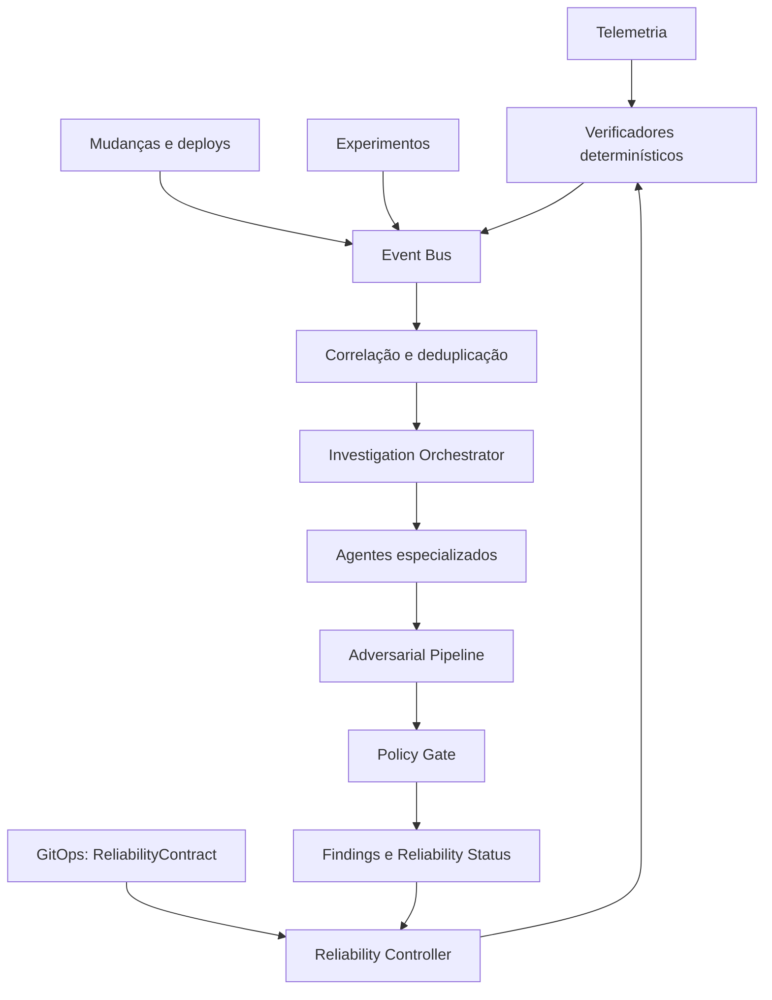
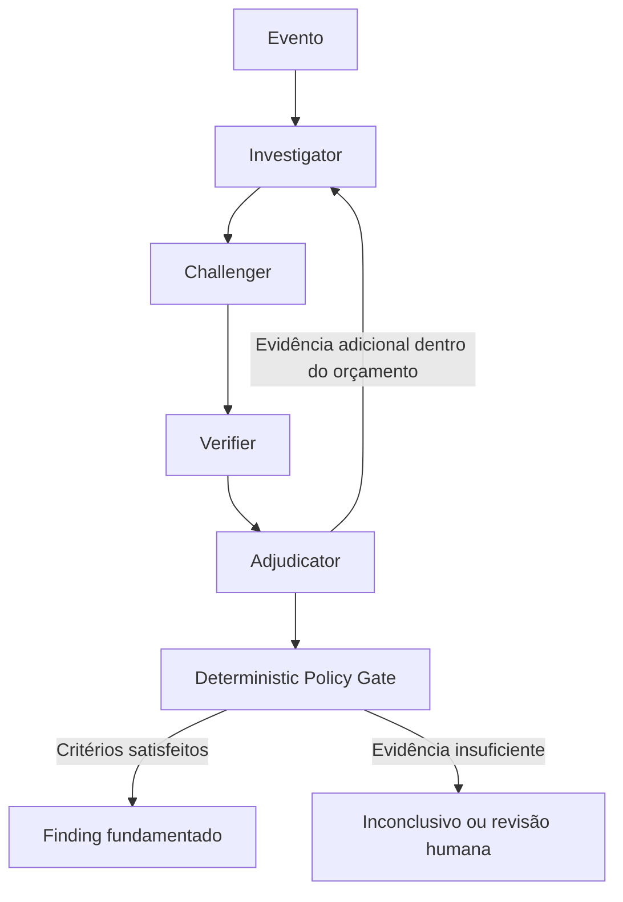
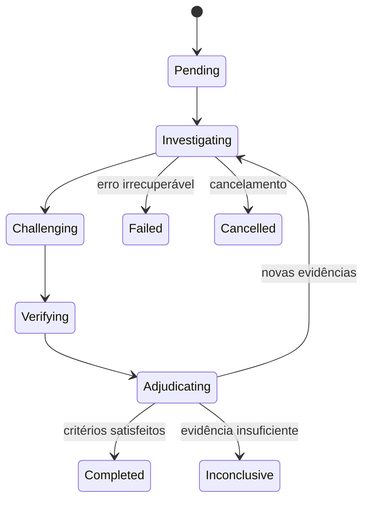
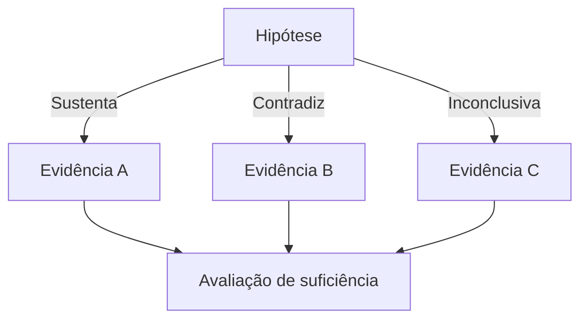
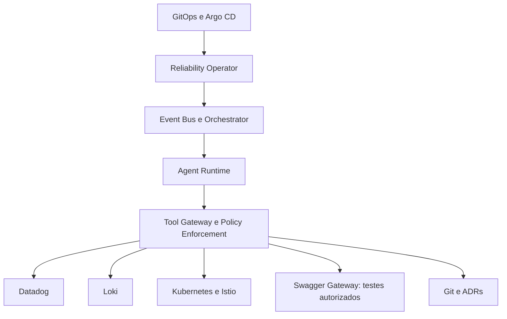

# Declarative Reliability & Adversarial Intelligence

**Data:** 2026-11-26  
**Status:** Brainstorm — proposta conceitual

## 1. Tese

A confiabilidade deve ser uma propriedade declarada, continuamente verificada, experimentalmente validada e sistematicamente contestada.

O contrato estabelece o que deve ser verdade. A observabilidade fornece evidências. Os agentes investigam. A pipeline adversarial contesta. Os verificadores validam. A governança determina o que pode ser feito.

Este é o quarto eixo da reflexão sobre o Reliability Control Plane:

- [O futuro da observabilidade e da engenharia de confiabilidade](2026-11-24-futuro-observabilidade-engenharia-confiabilidade.md).
- [Architectural Reliability Intelligence](2026-11-24-architectural-reliability-intelligence.md).
- [Failure-Aware Architecture & Resilience Intelligence](2026-11-25-failure-aware-architecture-resilience-intelligence.md).

## 2. Reliability as Code

Assim como GitOps reconcilia o estado dos recursos, Reliability as Code verifica propriedades comportamentais desejadas de uma capacidade de negócio. Reconciliação não implica necessariamente alteração do sistema.

| GitOps | Reliability as Code |
|---|---|
| Estado desejado de recursos | Comportamento desejado |
| Resource drift | Reliability drift |
| Manifesto | Contrato de confiabilidade |
| Reconciliação | Verificação de propriedades |
| Health status | Estado de confiabilidade |
| Sincronização | Investigação, validação e eventual mitigação |

A confiabilidade é distribuída, temporal e parcialmente observável. A ausência de falhas observadas não comprova satisfação de uma propriedade.

## 3. ReliabilityContract

Exemplo conceitual de recurso declarativo, potencialmente implementado como CRD:

```yaml
apiVersion: reliability.io/v1alpha1
kind: ReliabilityContract
metadata:
  name: ofertas-api
spec:
  businessCapability: consulta-de-ofertas
  target:
    application: ofertas-api
    scope: multicluster
  objectives:
    availability:
      target: 99.99
      window: 30d
    latency:
      percentile: 99
      maxMilliseconds: 250
      window: 5m
  dependencies:
    - name: cadastro-api
      type: synchronous
      criticality: mandatory
      ownership: external
      expectations:
        availability: 99.99
        latencyBudgetMs: 100
      resilience:
        timeoutMs: 150
        circuitBreaker: required
        fallback: none
    - name: recomendacoes-api
      type: synchronous
      criticality: optional
      resilience:
        timeoutMs: 80
        fallback:
          strategy: omit-recommendations
          maxDuration: 15m
  invariants:
    - name: preserve-authorization
      description: Nenhum fallback pode contornar autorização.
    - name: preserve-business-capability
      description: Falha de recomendações não deve impedir consulta de ofertas.
  verification:
    interval: 5m
    evidenceMaxAge: 10m
  investigation:
    triggerOn:
      - ObjectiveViolation
      - DependencyDegradation
      - UnexpectedFallback
      - TopologyDrift
      - ArchitectureChange
  adversarial:
    enabled: true
    challengeHypotheses: true
    requireIndependentEvidence: true
    requireAlternativeExplanations: true
  remediation:
    mode: advisory
    approvalRequired: true
```

O exemplo é ilustrativo, não um schema implementado. Objetivos precisam definir população de requisições, critérios de sucesso funcional, unidade, janela, agregação, escopo, volume mínimo e tratamento de dados ausentes. Disponibilidade de uma dependência não garante disponibilidade equivalente da jornada composta. P99 em cinco minutos é um critério de janela curta, distinto de um SLO mensal baseado na proporção de requisições dentro do limite.

Invariantes descritos em linguagem natural devem possuir assertions executáveis; testes finitos fornecem evidência dentro do escopo testado, não prova universal de segurança.

## 4. Propriedades verificáveis

| Categoria | Mecanismo |
|---|---|
| Determinística | Métricas, inspeção de configuração, cálculo e políticas |
| Experimental | Testes funcionais, falhas controladas, fallback e recuperação |
| Investigativa | Hipóteses causais, análise arquitetural e interpretação contextual |

O LLM não substitui verificadores determinísticos. Ele pode selecionar ferramentas, formular hipóteses e interpretar resultados.

```yaml
assertions:
  - name: latency-objective
    type: metric
    verifierRef: latency-p99
    operator: LessThanOrEqual
    expected: 250
    unit: milliseconds
    window: 5m
  - name: authorization-preserved
    type: policy
    verifierRef: authorization-policy
  - name: optional-dependency-isolation
    type: experiment
    verifierRef: recommendations-failure-test
    expected: business-capability-preserved
  - name: architectural-risk
    type: investigation
    verifierRef: dependency-risk-agent
    adversarialReview: required
```

Um catálogo versionado de ReliabilityVerifier desacopla a intenção das ferramentas (Datadog, Prometheus ou outras). Cada verificador deve definir parâmetros tipados, fontes, permissões, semântica de avaliação, critérios de suficiência e validade da evidência. Resultado deve ser True, False ou Unknown, com motivo e referências. Erro de consulta não é violação do SLO nem evidência de satisfação.

## 5. Arquitetura orientada a eventos



A camada determinística opera continuamente; agentes são mobilizados quando há necessidade de investigação. Eventos podem representar violações, alterações arquiteturais ou perda de evidência, mesmo sem incidentes.

Eventos possíveis: ReliabilityContractChanged, SLOBudgetBurnDetected, DependencyLatencyIncreased, NewDependencyDiscovered, FallbackActivated, FallbackExhausted, DeploymentCompleted, ResilienceTestFailed, EvidenceExpired e ArchitectureDriftDetected.

Exemplo compatível com o envelope CloudEvents:

```json
{
  "specversion": "1.0",
  "id": "evt-001",
  "type": "reliability.dependency.degraded",
  "source": "/observability/dependencies",
  "subject": "ofertas-api",
  "time": "2026-11-26T22:00:00Z",
  "data": {
    "contractRef": "ofertas-api",
    "dependency": "cadastro-api",
    "assertion": "dependency-latency",
    "expectedMs": 100,
    "observedMs": 850,
    "evidenceRef": "evidence-784",
    "correlationId": "incident-123"
  }
}
```

O evento representa uma observação, não uma conclusão causal. Complementos operacionais: entrega ao menos uma vez com consumidores idempotentes, deduplicação por source/id, correlação por jornada e versão do contrato, agrupamento temporal, backpressure, cooldown, retry limitado e dead-letter queue. Reconciliação periódica deve detectar eventos perdidos. Eventos produzidos pela própria investigação não devem gerar recursão ilimitada.

## 6. Adversarial Reliability Pipeline

O objetivo não é obter consenso entre modelos, mas tentar refutar conclusões por meio de evidências.



| Papel | Responsabilidade |
|---|---|
| Investigator | Coletar evidências e formular hipóteses causais |
| Challenger | Procurar contradições e explicações alternativas |
| Verifier | Executar verificações independentes e reproduzíveis |
| Adjudicator | Avaliar suporte e limitações das hipóteses |
| Policy Gate | Aplicar critérios determinísticos de aceitação e autorização |

O Challenger deve poder solicitar novas ações investigativas, não apenas criticar texto. A independência reside principalmente nas fontes e métodos de verificação; modelos diferentes podem compartilhar vieses. Uma primeira análise independente antes de apresentar a hipótese original pode reduzir ancoragem.

O Policy Gate não é um LLM. Ele verifica integridade, proveniência, validade temporal, escopo, requisitos de evidência e permissões. Não pode provar causalidade apenas pela existência de referências. Divergências materiais não resolvidas devem permanecer explícitas.

### Ciclo de vida da investigação



Estados ilustrativos. Qualquer etapa ativa deve respeitar deadline, cancelamento e orçamento de ferramentas, tokens, custo e iterações. Persistir checkpoints e tentativas; separar falha de execução de conclusão inconclusiva. Uma investigação deve referenciar a geração do contrato e a janela de observação; resultados obsoletos não podem sobrescrever o status atual.

## 7. Exemplo de investigação

Cenário hipotético: P99 de 1.850 ms para objetivo de 250 ms.

1. Investigator identifica aumento de latência na dependência cadastral e propõe degradação externa.
2. Challenger considera CPU throttling, DNS, contenção local e saturação de conexões como explicações alternativas.
3. Verifier consulta métricas, traces e conexões e identifica degradação semelhante em consumidores de outro cluster.
4. Adjudicator considera a hipótese externa mais sustentada, sem afirmar a causa interna de um sistema não observável.
5. Finding arquitetural: ausência de isolamento funcional permite que a degradação comprometa a capacidade de negócio.

A comparação entre clusters não exclui causas compartilhadas de infraestrutura. A conclusão deve indicar alternativas remanescentes, escopo e limitações. A contestação gera novas evidências.

## 8. Evidence Graph

Evidências são objetos de primeira classe, conectados ao Architectural Reliability Graph.

```yaml
apiVersion: reliability.io/v1alpha1
kind: ReliabilityEvidence
metadata:
  name: evidence-784
spec:
  source: datadog
  type: metric-query
  subject:
    application: ofertas-api
    dependency: cadastro-api
  observation:
    metric: dependency.latency.p99
    value: 850
    unit: milliseconds
  provenance:
    queryRef: query-381
    resultRef: result-982
    collectedAt: "2026-11-26T22:00:00Z"
    expiresAt: "2026-11-26T22:10:00Z"
```

Complemento: registrar janela de observação, identidade do coletor, versão do verificador, escopo, parâmetros, digest do resultado e classificação de dados. Evidências devem ser imutáveis ou versionadas; expiração impede seu uso como prova de estado atual, mas não elimina seu valor histórico.



O contrato de finding deve registrar hipóteses, evidências favoráveis e contrárias, verificações pendentes, grau de suporte justificado, lacunas, impacto de negócio, recomendações e responsáveis. Evitar percentuais de confiança arbitrários e distinguir observação, inferência e validação experimental.

## 9. Duas dimensões adversariais

| | Adversarial Reasoning | Adversarial Testing |
|---|---|---|
| Objeto | Conclusão do agente | Propriedade da arquitetura |
| Mecanismo | Refutação de hipóteses | Injeção controlada de falhas |
| Objetivo | Confiabilidade do diagnóstico | Confiabilidade da solução |
| Resultado | Finding fundamentado | Evidência experimental |
| Ambiente | Somente leitura | Ambiente autorizado e controlado |

Se o contrato declara que falha de recomendações não impede consulta de ofertas, um experimento em homologação deve tentar refutar essa propriedade sob condições definidas de carga, duração e falha. Validar também recuperação e preservação da autorização. Testes precisam de aprovação, limites de impacto, critérios de interrupção e limpeza. Não executar experimentos automaticamente em produção na primeira fase.

## 10. Status declarativo

```yaml
status:
  observedGeneration: 7
  phase: Degraded
  conditions:
    - type: AvailabilitySatisfied
      status: "True"
    - type: LatencySatisfied
      status: "False"
      reason: ObjectiveViolation
    - type: FallbackValidated
      status: "Unknown"
      reason: EvidenceExpired
    - type: ArchitectureConformant
      status: "True"
    - type: InvestigationCompleted
      status: "True"
    - type: AdversarialReviewCompleted
      status: "True"
  activeFindings:
    - findingRef: finding-123
      severity: high
      category: architectural-risk
  lastVerifiedAt: "2026-11-26T22:05:00Z"
```

Condições devem possuir observedGeneration, reason, message, lastTransitionTime e referências de evidência conforme o modelo adotado. A fase agregada deve ser derivada por regras explícitas de criticidade e não esconder estados Unknown. Conclusão de investigação não significa resolução da violação. Evidências experimentais e operacionais podem exigir prazos de validade distintos.

## 11. Materialização na plataforma



O Swagger Gateway pode fornecer descoberta e testes funcionais controlados em homologação; o Generator Plugin pode fornecer contexto de distribuição multicluster. OPA pode autorizar chamadas de ferramentas, complementado por identidade, RBAC, credenciais de menor privilégio e controles no próprio gateway.

O Reliability Control Plane deve permanecer independente do Generator Plugin. Agentes não devem receber credenciais amplas nem interpretar conteúdo de logs, traces ou documentos como instruções. Aplicar minimização, mascaramento, segregação por tenant e ambiente, auditoria e políticas de retenção. Recomendações não equivalem a autorização de execução.

## 12. Modelo de recursos e persistência

| Recurso | Responsabilidade |
|---|---|
| ReliabilityContract | Propriedades esperadas |
| ReliabilityVerifier | Definição da verificação |
| ReliabilityEvent | Evento relevante |
| ReliabilityInvestigation | Ciclo de investigação |
| ReliabilityEvidence | Evidências verificáveis |
| ReliabilityFinding | Conclusões e riscos |

Contratos, definições de verificadores e estado consolidado podem ser CRDs. Eventos, evidências volumosas e histórico devem residir em armazenamento especializado, com referências no status; evitar transformar etcd em banco de observabilidade. A escolha de event bus, runtime de agentes, banco e orquestrador fica em aberto.

## 13. Prova de conceito

1. Declarative Reliability: uma aplicação, contrato e verificadores determinísticos de disponibilidade e latência.
2. Event-Driven Investigation: violações acionam agente somente leitura.
3. Adversarial Reasoning: Challenger, verificação independente e adjudicação.
4. Adversarial Testing: experimentos autorizados em homologação.
5. Architectural Intelligence: persistência de findings, recorrências e backlog arquitetural.

Avaliar contra cenários com causa conhecida, causas combinadas, evidência ausente e hipótese inicial incorreta. Comparar pipeline adversarial com agente único: precisão da atribuição, conclusões sem suporte, capacidade de abstinência, tempo, custo e utilidade das recomendações. A adversarialidade deve demonstrar benefício mensurável, não apenas aumentar complexidade.

Não introduzir remediação autônoma inicialmente. Antes de delegar ação, demonstrar capacidade de investigar, contestar e produzir conclusões confiáveis.

## 14. Próxima etapa

Aprofundar a especificação formal do ReliabilityContract, a semântica das assertions, o ciclo de vida das investigações e os critérios de aceitação de evidências. Esses elementos devem formar a base técnica do Reliability Control Plane.

**O contrato declara a intenção; a evidência sustenta a avaliação; a contestação reduz conclusões precipitadas; a governança limita a ação.**

Todos os contratos, diagramas e mecanismos aqui apresentados são propostas exploratórias, não especificações implementadas ou validadas em produção.

## Reflexão complementar: investigação guiada por humanos

- [Human-Guided Reliability Intelligence](2026-11-26-human-guided-reliability-intelligence.md): investigação multidimensional, dossiê de evidências, workspace de decisão humana e aprendizado institucional no horizonte 2027–2028.
