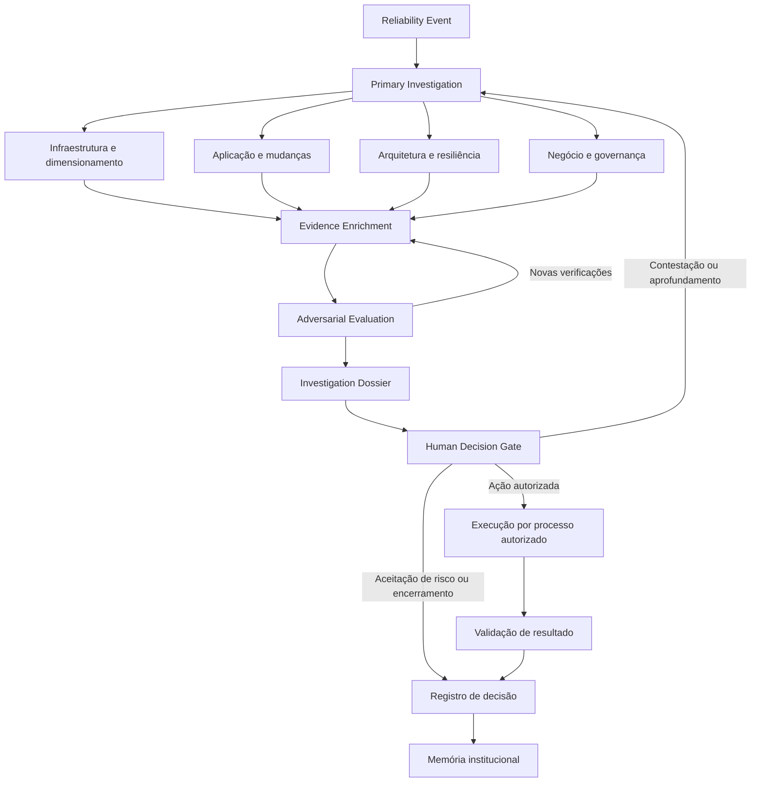
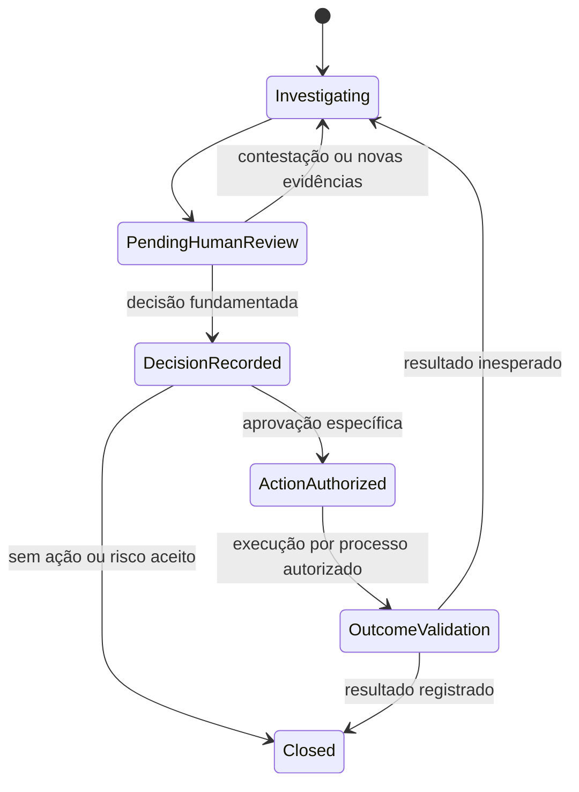

# Human-Guided Reliability Intelligence

**Data:** 2026-11-26  
**Status:** Brainstorm — proposta conceitual  
**Horizonte:** 2027–2028 — Investigative Reliability Control Plane (IRCP)

## 1. Tese

O objetivo não é substituir o julgamento humano, mas enriquecer as condições sob as quais esse julgamento acontece.

O sistema deve investigar, produzir conclusões, submetê-las a avaliações enriquecidas por conjuntos distintos de dados e evidências e apresentar o contexto consolidado a um responsável humano, que poderá aceitar ou refutar hipóteses, solicitar aprofundamento ou decidir implementar uma ação.

A autonomia investigativa não implica autonomia operacional. O horizonte 2027–2028 representa a construção de confiança epistemológica; os horizontes adaptativo (2029–2031) e de autonomia delimitada (2032–2035) dependem de evidências de maturidade, não simplesmente da passagem do tempo.

Este brainstorm complementa:

- [O futuro da observabilidade e da engenharia de confiabilidade](2026-11-24-futuro-observabilidade-engenharia-confiabilidade.md)
- [Architectural Reliability Intelligence](2026-11-24-architectural-reliability-intelligence.md)
- [Failure-Aware Architecture & Resilience Intelligence](2026-11-25-failure-aware-architecture-resilience-intelligence.md)
- [Declarative Reliability & Adversarial Intelligence](2026-11-26-declarative-reliability-adversarial-intelligence.md)

## 2. Investigação multidimensional

| Dimensão | Contexto e evidências |
|---|---|
| Infraestrutura | Nodes, rede, storage, DNS, balanceadores, serviços cloud |
| Dimensionamento | Requests, limits, throttling, capacidade, concorrência, autoscaling |
| Aplicação | Erros, runtime, comportamento funcional, consumo de recursos |
| Arquitetura | Acoplamento, dependências, comunicação síncrona, pontos de falha |
| Resiliência | Fallback, circuit breaker, timeout, retry, recuperação |
| Mudanças | Deployments, configurações, releases, mudanças de infraestrutura |
| Negócio | Jornadas afetadas, criticidade, impacto funcional |
| Governança | Segurança, compliance, políticas institucionais |

Dimensões não exigem necessariamente agentes distintos. O orquestrador seleciona especializações e ferramentas conforme evento, contrato e criticidade. Registrar dimensões avaliadas, não aplicáveis e não avaliadas, com justificativa. Ausência de evidência não equivale a ausência de problema.

## 3. Pipeline de investigação e enriquecimento



A conclusão inicial é objeto de avaliação, não resultado definitivo. Avaliações independentes podem ocorrer antes da exposição à hipótese inicial para reduzir ancoragem. Diversidade de fontes, métodos, escopos e janelas temporais importa mais do que quantidade de agentes. Fontes derivadas da mesma telemetria não devem ser tratadas automaticamente como independentes.

O Challenger solicita verificações adicionais; o Verifier executa consultas reproduzíveis; o Adjudicator consolida suporte e contradições; o Policy Gate verifica requisitos determinísticos. Limitar iterações, tempo e custo. Resultados inconclusivos devem permanecer possíveis.

## 4. Causalidade multidimensional

Exemplo hipotético: P99 observado de 1.850 ms, objetivo de 250 ms.

| Dimensão | Avaliação ilustrativa |
|---|---|
| Infraestrutura | Sem anomalias identificadas no escopo observado |
| Dimensionamento | CPU throttling como possível fator contribuinte |
| Aplicação | Retries como possível amplificador |
| Dependências externas | Degradação cadastral como provável desencadeador |
| Arquitetura | Dependência síncrona obrigatória sem isolamento funcional |
| Resiliência | Ausência de alternativa funcional para a jornada |

A investigação deve avaliar composição de condições, não pressupor causa raiz singular. Classificar relações como desencadeadoras, contribuintes, amplificadoras, estruturais ou mitigadoras. Uma associação temporal ou configuração observada não prova contribuição causal. A causa interna de uma dependência externa pode permanecer desconhecida.

## 5. InvestigationDossier

Objeto estruturado, navegável, versionado e auditável, principal interface entre agentes e responsáveis humanos.

```yaml
kind: InvestigationDossier
metadata:
  name: investigation-001
spec:
  contractRef: ofertas-api
  eventRef: latency-violation-001
  hypotheses:
    - id: H01
      category: triggering-cause
      dimension: external-dependency
      conclusion: external-service-degradation
      assessment: supported
      supportingEvidence: [evidence-001, evidence-002]
      contradictingEvidence: []
    - id: H02
      category: contributing-factor
      dimension: sizing
      conclusion: cpu-throttling
      assessment: partially-supported
    - id: H03
      category: structural-cause
      dimension: architecture
      conclusion: mandatory-synchronous-dependency
      assessment: supported
  limitations:
    - external-service-internal-state-unavailable
  recommendations:
    - id: R01
      type: operational
      action: review-retry-policy
    - id: R02
      type: architectural
      action: evaluate-dependency-isolation
  decision:
    status: PendingHumanReview
```

Schema ilustrativo. Uma implementação deve registrar geração do contrato, revisão do dossiê, janela de observação, versões dos verificadores, referências às evidências originais, avaliações por dimensão, alternativas, contradições e verificações pendentes. Hipóteses podem ser sustentadas, parcialmente sustentadas, refutadas ou inconclusivas. Evitar confiança numérica sem calibração. Separar avaliação automatizada de decisão humana; uma contestação humana não transforma automaticamente uma hipótese em falsidade comprovada.

## 6. Investigation Workspace

A experiência não deve se limitar a um chatbot. O workspace deve permitir navegação do evento à conclusão e da conclusão à evidência original.

| Visão | Experiência esperada |
|---|---|
| Resumo | Contrato violado, jornada, impacto, estado e limitações |
| Timeline | Eventos, mudanças, ações e relações causais propostas |
| Dimensões | Avaliações especializadas, cobertura e lacunas |
| Hipóteses | Suporte, contradições, alternativas e histórico |
| Evidências | Fonte, consulta, resultado, janela, validade e proveniência |
| Recomendações | Impacto esperado, risco, pré-condições e validação |
| Decisões | Aceitação, contestação, aprofundamento, revisão e autorização |

O humano pode avaliar cada hipótese independentemente, anexar evidências, justificar divergências e solicitar investigação direcionada. A interface deve mostrar o que mudou entre revisões, preservar o histórico e distinguir claramente evidência de inferência. Uma contestação gera evento correlacionado à hipótese e revisão, sem apagar a avaliação anterior.

## 7. Human-in-the-Reasoning-Loop

| Human-in-the-Loop tradicional | Human-in-the-Reasoning-Loop |
|---|---|
| Aprova ação | Participa da construção do conhecimento |
| Avalia resultado final | Questiona hipóteses intermediárias |
| Aceita ou rejeita recomendação | Solicita evidências adicionais |
| Controla execução | Orienta também a investigação |

Aceitar uma hipótese e autorizar uma ação são decisões independentes. Um responsável pode reconhecer fragilidade arquitetural e adiar intervenção por restrições econômicas, regulatórias ou estratégicas.

### Contrato conceitual de decisão

```yaml
kind: InvestigationDecision
spec:
  dossierRef: investigation-001
  dossierRevision: 3
  hypothesisRef: H02
  type: RequestFurtherInvestigation
  rationale: Isolar contribuição do throttling para a latência.
  requestedEvidence:
    - comparação entre períodos equivalentes de carga
```

A identidade e o horário do decisor devem ser registrados pelo sistema autenticado. Decisões possíveis incluem AcceptHypothesis, DisputeHypothesis, RequestFurtherInvestigation, RequestReview, AcceptRisk e AuthorizeAction. A autorização de ação deve referenciar recomendação específica, escopo, versão, permissões e processo de mudança aplicável; não pode ser inferida da aceitação de uma hipótese.

## 8. Ciclo de vida humano



Modelo conceitual. Investigações inconclusivas, canceladas ou expiradas devem ter estados explícitos. Revisões concorrentes exigem controle de versão; mudanças relevantes de contexto podem exigir nova avaliação. No primeiro horizonte, não há remediação autônoma em produção.

## 9. Aprendizado institucional

Preservar hipóteses, evidências, justificativas humanas, restrições, decisão e resultados posteriores. A autoridade do decisor não garante correção factual. A validação do resultado deve considerar efeitos esperados, efeitos adversos e fatores concorrentes.

A memória institucional pode apoiar investigações futuras, mas não deve transformar decisões antigas em verdades universais. Registrar escopo, validade temporal, versão arquitetural e proveniência. Aplicar controle de acesso, minimização de dados, retenção e revisão de conhecimento obsoleto.

## 10. Escopo do IRCP 2027–2028

1. Declarative Reliability: estabelecer o que deve ser verdade.
2. Multidimensional Investigation: investigar sob diferentes perspectivas.
3. Adversarial Intelligence: contestar conclusões e enriquecer evidências.
4. Human Decision Workspace: permitir participação humana na investigação e decisão.
5. Institutional Learning: preservar conhecimento e validar efeitos das decisões.

## 11. Prova de conceito e critérios de sucesso

Selecionar uma jornada com contrato verificável, dependência externa e telemetria de infraestrutura e aplicação. Gerar eventos controlados em homologação, comparar investigações com causa conhecida e testar contestação humana direcionada.

Avaliar precisão de atribuição, cobertura de dimensões relevantes, rastreabilidade das conclusões, reconhecimento de lacunas, redução de afirmações sem suporte, tempo de investigação, custo e utilidade percebida pelos responsáveis. Comparar agente único e pipeline multidimensional adversarial. Medir também se a revisão humana consegue corrigir hipóteses equivocadas sem descartar evidências válidas.

A primeira implementação deve operar com ferramentas somente leitura em produção e testes autorizados em homologação. A escolha de tecnologias e a especificação formal dos contratos e da interface permanecem abertas.

## 12. Reflexão final

O produto final não é uma resposta gerada por um LLM, mas um processo investigativo verificável que melhora as condições para a decisão humana.

**Investigar, enriquecer, contestar, decidir e aprender.**

Os modelos, diagramas e contratos deste documento são propostas exploratórias, ainda não implementadas ou validadas em produção.
